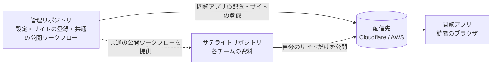

# Artifact Pages ドキュメント

Artifact Pagesは、各チームがGitで書いたHTMLとMarkdownの資料を、社内のひとつの場所で探して読めるようにする仕組みです。このドキュメントは、それを組織に用意するプラットフォーム担当者に向けて書いています。

## 組織に提供できるもの

- **チームは自分のリポジトリから公開する。** HTML、Markdownと、それが使うCSSや画像を、ビルドなしでそのまま公開します。公開はGitHub Actionsのジョブで、マージのたびに行えます。資料の正本はGitで、Artifact Pagesの中で編集はしません。
- **プルリクエストの変更をプレビューで確かめる。** 変更した資料を、本公開とは別の場所に公開して確認できます。プレビューは本公開の一覧や検索には混ざりません。
- **どのチームの資料も、同じ画面で探して読む。** 読者はブラウザで共通の閲覧アプリを開き、サイトを切り替え、タイトルやパス、本文の言葉で資料を探します。目次、ページや見出しのURL、更新日、GitHubの公開元へのリンクも、どのサイトでも同じように使えます。
- **それぞれが独立して更新される。** 各サイトは、ほかのサイトの公開を待たずに自分の範囲だけを公開します。閲覧アプリも資料とは別に更新でき、そのたびに全サイトを公開し直す必要はありません。
- **自社のCloudflareかAWSで動く。** 配信はオブジェクトストレージとCDNだけで、リクエストを処理するサーバーを常に動かす必要はありません。環境はTerraformのモジュールで作ります。

Artifact Pagesには、利用者のアカウントやログイン、サイトごとの閲覧権限はありません。社内だけに見せる制限は、配信先のホスト名に対してIPアドレスやCloudflare Accessなどで設定します。

## 全体の形

ひとつの環境は、管理リポジトリ1つと、資料を公開するチームのリポジトリ（以下、サテライトリポジトリ）でできています。

- **管理リポジトリ**は、配信先の設定、登録するサイトの一覧、CLIと閲覧アプリのバージョンを持ちます。各チームが呼び出す共通の公開とプレビューのワークフローも、ここから配ります。
- **サテライトリポジトリ**は、各チームのふだんのリポジトリです。製品のコードと同じリポジトリでも構いません。Artifact Pagesのために足すのは、公開する資料のディレクトリと、共通のワークフローを呼び出す短いワークフローだけです。
- **配信先**には、閲覧アプリと、公開されたすべてのサイトが入ります。
- **閲覧アプリ**は、サイトの一覧と、開いたサイトの資料の一覧を読み込み、探す・読むための画面を提供します。

## 次に読むもの

| 目的 | 章 |
| --- | --- |
| 何ができて、利用者にどう役立つかを知る | [体験と機能](01-features/index.html) |
| 環境を作り、最初のチームの公開とPRプレビューまで進める | [導入する](02-setup/index.html) |
| 次のチームに広げ、更新し、問題に対処する | [社内展開と運用](03-operations/index.html) |
| なぜこの構成なのか、どこに境界があるかを知る | [アーキテクチャ](04-architecture/index.html) |
| 設定、CLI、Actions、Terraform、閲覧アプリの操作を引く | [リファレンス](05-reference/index.html) |
